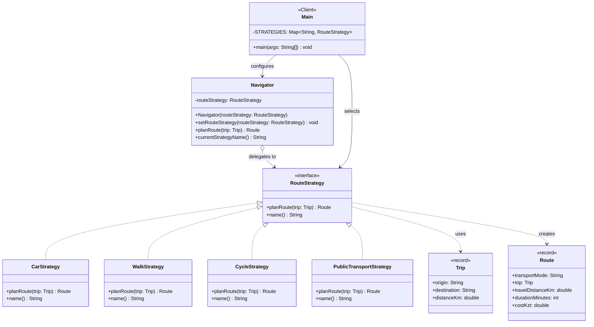

# Assignment #5 — Strategy Pattern: Report

**Course:** ShP-2216 – Software Design Patterns<br>
**Topic:** Option A — Navigation / Route Planning<br>
**Language:** Java 17, IntelliJ IDEA<br>
**GitHub repository:** [https://github.com/mrmbk-wq/Strategy-Pattern](https://github.com/mrmbk-wq/Strategy-Pattern)

---

## 1. Introduction

The chosen domain is a city navigator. A user enters a trip (origin, destination and
straight-line distance), and the navigator returns a route: the real travel distance,
the duration and the cost. The algorithm used to compute that route depends on how the
user travels, so the domain has a natural **family of algorithms**:

| Strategy                  | Detour factor | Speed     | Cost rule                          |
|---------------------------|---------------|-----------|------------------------------------|
| `CarStrategy`             | 1.25 (roads)  | 40 km/h   | fuel: 0.08 L/km × 280 KZT          |
| `WalkStrategy`            | 1.05 (paths)  | 5 km/h    | free                               |
| `CycleStrategy`           | 1.15 (lanes)  | 15 km/h   | 300 KZT per started 30 min rental  |
| `PublicTransportStrategy` | 1.30 (bus)    | 25 km/h   | 8 min wait + flat fare 100 KZT     |

Without the Strategy pattern, this would be one `planRoute(trip, mode)` method with a
`switch (mode)` that grows every time a new transport mode appears. With the pattern,
each algorithm lives in its own class behind the `RouteStrategy` interface, and the
`Navigator` (Context) simply delegates to whichever strategy it currently holds. The
client can replace the strategy at runtime with `navigator.setRouteStrategy(...)`.

## 2. UML Class Diagram



Text version of the same diagram (for viewers that do not render Mermaid):

```
          ┌──────────────┐  configures   ┌───────────────────────────────┐
          │ Main (Client)│──────────────>│ Navigator (Context)           │
          │ STRATEGIES   │               │ - routeStrategy: RouteStrategy│
          └──────┬───────┘               │ + setRouteStrategy(s)         │
                 │ selects               │ + planRoute(trip): Route      │
                 v                       └──────────────┬────────────────┘
       ┌──────────────────────────┐                     │ delegates to (aggregation)
       │ <<interface>>            │<────────────────────┘
       │ RouteStrategy            │
       │ + planRoute(Trip): Route │
       │ + name(): String         │
       └────────────▲─────────────┘
          ┌─────────┼──────────┬───────────────────┐  (implements)
   CarStrategy  WalkStrategy  CycleStrategy  PublicTransportStrategy
```

## 3. Clean Code Principles

### 3.1 Conditional logic replaced by polymorphism

**Before** (what the code would look like without the pattern):

```java
public Route planRoute(Trip trip, String mode) {
    if (mode.equals("car")) {
        double km = trip.distanceKm() * 1.25;
        return new Route("Car", trip, km, (int) Math.ceil(km / 40 * 60), km * 0.08 * 280);
    } else if (mode.equals("walk")) {
        double km = trip.distanceKm() * 1.05;
        return new Route("Walk", trip, km, (int) Math.ceil(km / 5 * 60), 0);
    } else if (mode.equals("cycle")) {
        // ...
    }
    throw new IllegalArgumentException("Unknown mode " + mode);
}
```

**After** (`context/Navigator.java`):

```java
public Route planRoute(Trip trip) {
    return routeStrategy.planRoute(trip);   // the object itself decides which algorithm runs
}
```

The Context contains no branch on transport type. Even the client does not branch on the
type: it looks the strategy up in a `Map<String, RouteStrategy>` (`Main.java`), so the
only `if` left there is input validation for an unknown key.

### 3.2 Meaningful, intention-revealing names

```java
public class CycleStrategy implements RouteStrategy {
    private static final double BIKE_LANE_DETOUR_FACTOR = 1.15;
    private static final double CYCLING_SPEED_KMH = 15.0;
    private static final int RENTAL_PERIOD_MINUTES = 30;
    private static final double RENTAL_PRICE_KZT = 300.0;
```

Class names say which algorithm they contain (`CarStrategy`, `WalkStrategy`, ...), the
method `planRoute` says what it does, and there are no magic numbers: `km / 15 * 60`
becomes `laneDistanceKm / CYCLING_SPEED_KMH * 60`, and units (`Km`, `Kmh`, `Kzt`,
`Minutes`) are part of the names, so the reader does not have to guess them.

### 3.3 Single Responsibility Principle

Each class has one reason to change:

| Class                     | Its only responsibility                         |
|---------------------------|-------------------------------------------------|
| `CarStrategy` etc.        | one route-planning algorithm                    |
| `Navigator`               | hold the current strategy and delegate to it    |
| `Main`                    | choose strategies and talk to the user          |
| `Trip`, `Route`           | carry data (immutable records)                  |

For example, if fuel prices change, only `CarStrategy` is edited:

```java
private static final double FUEL_PRICE_KZT = 280.0;   // affects only the car algorithm
```

### 3.4 Context is algorithm-agnostic

```java
public class Navigator {
    private RouteStrategy routeStrategy;        // depends on the abstraction only

    public void setRouteStrategy(RouteStrategy routeStrategy) {
        this.routeStrategy = Objects.requireNonNull(routeStrategy, "routeStrategy must not be null");
    }
```

`Navigator` imports only `RouteStrategy`, `Trip` and `Route` — not a single concrete
strategy. This is the Dependency Inversion Principle: the high-level class depends on an
interface. The `requireNonNull` guard in the constructor/setter also means the Context
never needs a `null` check before delegating.

### 3.5 Easy extensibility (Open/Closed Principle)

`PublicTransportStrategy` was added in a separate commit
("Add PublicTransportStrategy without modifying existing classes"). The diff of that
commit touches **no** existing strategy and **not** `Navigator`. The only change outside
the new file is one registration line in the client:

```java
register("bus", new PublicTransportStrategy());
```

The system is open for extension (new algorithm = new class) and closed for
modification (tested classes stay untouched).

### 3.6 Small functions and immutable data (bonus)

Every `planRoute` method is 4–5 lines and works at one level of abstraction. `Trip` and
`Route` are Java `record`s, so they are immutable, and `Trip` validates its input in a
compact constructor (`distanceKm` must be positive) instead of every strategy checking it.

## 4. Runtime Strategy Switching (demo)

```java
Navigator navigator = new Navigator(STRATEGIES.get("car"));
STRATEGIES.values().forEach(strategy -> {
    navigator.setRouteStrategy(strategy);          // swap the algorithm at runtime
    System.out.println(navigator.planRoute(trip));
});
```

Output:

```
Car               AITU (EXPO) -> Baiterek |    8.1 km |   13 min |     182 KZT
Walk              AITU (EXPO) -> Baiterek |    6.8 km |   82 min |       0 KZT
Bicycle           AITU (EXPO) -> Baiterek |    7.5 km |   30 min |     300 KZT
Public transport  AITU (EXPO) -> Baiterek |    8.5 km |   29 min |     100 KZT
```

After that, the program reads the transport name from the keyboard (`car`, `walk`,
`cycle`, `bus`) and switches the same `Navigator` object live.

## 5. Conclusion

**Flexibility gained:** algorithms can be swapped while the program runs, new transport
modes are added as new classes without editing tested code, each algorithm can be
understood and tested in isolation, and the Context stays short and free of conditionals.

**Cost:** the number of classes grew — one interface plus four strategy classes instead of
one method with a `switch`. The client must also know which strategies exist in order to
choose one. For two fixed, very simple variants this would be over-engineering; but route
planning is a family of algorithms that keeps growing (taxi, scooter, metro, ...), so the
extra classes pay for themselves quickly.

## 6. Repository

GitHub repository: [https://github.com/mrmbk-wq/Strategy-Pattern](https://github.com/mrmbk-wq/Strategy-Pattern)
